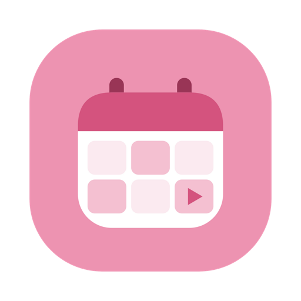

  

<h1 align="center">Ready Set Post!</h1>

A simple Mac app for planning, scheduling, and keeping track of your social media content.

<strong><a href="../../releases/latest">Download the latest version</a></strong>

---

## What it does

- **Plan your posts** with titles, captions, hashtags, and notes, as drafts or with a scheduled date
- **See everything on a calendar**, and drag a post to a new day to reschedule it
- **Keep track of what's posted**, scheduled, overdue, or still a draft from one dashboard
- **Get a reminder** when a scheduled post is due
- **Upload videos straight to YouTube**, now or scheduled for later
- **Plan TikTok and Instagram posts** with their captions ready, then post them yourself when the reminder comes
- **Open your accounts in the app** (TikTok, Instagram, Threads, X, LinkedIn), each signed in separately
- **Jot ideas down** in a 10-tab notepad with sticky notes
- **Sync across your Macs** through your own Google Drive (optional)
- **Make it yours** with light or dark mode, seven colour themes, and optional sounds

## Install

1. Go to the [latest release](../../releases/latest) and download the `.dmg` for your Mac:
   - **Apple chip** (M1, M2, M3, M4): the file ending in `arm64.dmg`
   - **Intel**: the other `.dmg`

   Not sure which you have? Apple menu → **About This Mac**: it says "Chip: Apple…" or "Processor: Intel…".
2. Open the `.dmg` and drag **Ready Set Post** into **Applications**.
3. The first time, **right-click the app → Open → Open**. The app isn't signed by Apple yet, so macOS asks you to confirm once.

## Good to know

- **Your content stays on your Mac.** Posts, notes, and settings are saved locally. Google Drive sync is optional and uses only a "Ready Set Post" folder in your own Drive.
- **Google Drive and YouTube features are invite-only for now.** While the app is in early access, Google only lets approved testers connect. Everything else works for everyone.
- **TikTok and Instagram can't be posted to automatically.** The app keeps your caption ready and reminds you, then you post it yourself.
- **Requires** macOS on an Apple chip or Intel Mac.

## Feedback

Found a bug or have an idea? [Open an issue](../../issues/new) — thank you!

---

Designed and developed by Isabel Agbu

